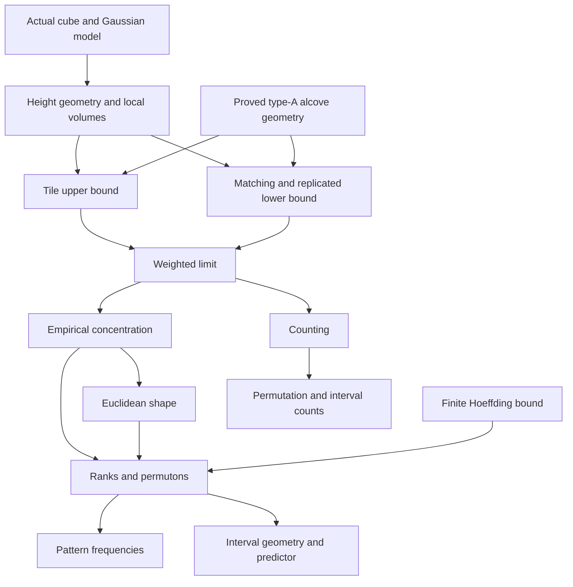

# Proof guide

The checked source is the November 19 manuscript. The release evidence records audited types, pinned dependencies, source hashes and transitive axioms. The [coverage table](PAPER_COVERAGE.md) distinguishes unconditional results from explicitly cited premises.

Start with a stable ID in [coverage.json](coverage.json), its complete certificate type, and the separate [proof-method comparison](proof-correspondence.json). The detailed appendix presents eight complete readable arguments. The finite Hoeffding estimate, the written Hölder estimate, the minimum-spanning-tree upper bound, common cube-shift support and finite segment subdivision are proved directly and used by the corresponding source certificates. Implementation details are identified individually; matching conclusions alone do not certify a written proof.

## Where to enter the proof

| Branch | Representative certificates and source files |
|---|---|
| Actual model | [`weightedPartition_eq_floorHeightIntegral`](../Antichain/GaussianPartitionIntegral.lean#L326) identifies the actual weighted expectation with the floor/height integral. [CubeModel](../Antichain/CubeModel.lean) and [GaussianFloorHeightLaw](../Antichain/GaussianFloorHeightLaw.lean) construct the laws. |
| Local geometry | [`heightGauge_norm_bounds_euclidean`](../Antichain/Geometry.lean#L256) gives the sharp norm bounds; [`boundary_matching_source`](../Antichain/BoundaryMatching.lean#L504) constructs the measurable common-boundary families. |
| Upper and lower bounds | [`normalizedPartitionLog_upper`](../Antichain/UpperBound.lean#L66) assembles tile estimates. [`matching_replication_source`](../Antichain/Replication.lean#L346) gives exact replicated volumes; [`normalizedPartitionLog_lower`](../Antichain/LowerBound.lean#L191) reaches all sample sizes. |
| Weighted limit and counting | [`weighted_volume_source_direct`](../Antichain/DirectSourceEndpoints.lean#L22) states the universal weighted limit. [`antichain_counting_source_direct`](../Antichain/DirectSourceEndpoints.lean#L37) gives the actual counting asymptotic. |
| Empirical law and shape | [`closed_cube_empirical_source_direct`](../Antichain/DirectSourceEndpoints.lean#L57) uses the literal closed-cube weak probability space. [`euclidean_shape_exponential_concentration_direct`](../Antichain/DirectSourceEndpoints.lean#L50) uses native Euclidean Hausdorff distance. |
| Ranks and applications | [`rank_permuton_source_hoeffding`](../Antichain/RankLimitsHoeffding.lean), [`fixed_pattern_frequency_source_hoeffding`](../Antichain/RankLimitsHoeffding.lean), and [`weakBruhat_interval_gaussian_source_hoeffding`](../Antichain/IntervalInversions.lean) state the rank, pattern and actual uniform-interval conclusions. |

## How the former inputs are proved

[`humphreysAlcoveInput_direct`](../Antichain/DirectAlcoveInput.lean#L15) proves all five actual alcove fields. [AffineAlcoveGroup](../Antichain/AffineAlcoveGroup.lean) and [AlcoveDiscreteness](../Antichain/AlcoveDiscreteness.lean) establish the integer-affine action and finite bounded orbits. [AlcoveCover](../Antichain/AlcoveCover.lean) proves coverage by a closest-point reflection argument. [AlcoveFundamentalDomain](../Antichain/AlcoveFundamentalDomain.lean) proves closed-representative uniqueness, same-tile map uniqueness and disjoint interiors.

The current rank proof uses [RankHoeffding](../Antichain/RankHoeffding.lean) for finite-sample displacement. [RankLimitsHoeffding](../Antichain/RankLimitsHoeffding.lean) carries it through the rank, signed and pattern applications. The old sharp DKW proof remains available in [DKWReverseMartingale](../Antichain/DKWReverseMartingale.lean). See [CITED_INPUTS.md](CITED_INPUTS.md) for the coordinate CLT and variational scope.

The written local arguments are available in [`MSTGaugeBound`](../Antichain/MSTGaugeBound.lean), [`RootedTreeOrder`](../Antichain/RootedTreeOrder.lean), [`CommonHeightHolder`](../Antichain/CommonHeightHolder.lean), [`CubeShiftSupport`](../Antichain/CubeShiftSupport.lean), and [`SegmentSubdivision`](../Antichain/SegmentSubdivision.lean). Their production call sites use these arguments, rather than merely importing unused helper theorems.

[OrientedCubeSource](../Antichain/OrientedCubeSource.lean) states the literal lower bound for independently oriented cubes. Its proof counts tiles in each frame and uses the matching and deletion construction shared with the weighted lower limit.

## Reviewing an edit

Follow imports backward from the affected certificate and check [CORRESPONDENCE.md](CORRESPONDENCE.md) for the source-object bridges. In particular, pinned index `r` means `r+1` points; floor volume is induced Euclidean volume; and the finite-Pi metric requires an explicit bridge to Euclidean Hausdorff distance. The public [theorem/source index](../release/theorem-source-index.json) and [import graph](../release/import-graph.json) provide finer navigation.

After an edit, rerun `python verify.py` and `python scripts/check_release.py` from the public repository root. Statement changes also need a new correspondence review and deliberate refresh of frozen evidence; editing an index does not update the proof certificate. See [PROOF_POLICY.md](../PROOF_POLICY.md).
